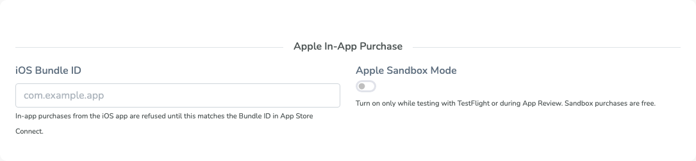

# Apple In-App Purchase

From v1.9.2, every iOS in-app purchase is verified against Apple's signed transaction before a package is granted.

:::warning Required after updating
iOS purchases are **refused** until the **iOS Bundle ID** is saved. It is empty after an update.
:::

## Setup

1. In **App Store Connect**, open your app → **App Information** and copy the **Bundle ID**.
2. In the Admin Panel, open `Settings` → `Payment Settings` → **Apple In-App Purchase**.
3. Paste it into **iOS Bundle ID** and save.

## Apple Sandbox Mode

Off by default: only real (Production) App Store purchases are accepted. Turn it on only while testing with TestFlight or during App Review.

:::danger
Sandbox purchases are free. While this is on, free test purchases unlock paid packages. Turn it off when the app is live.
:::

## Troubleshooting

| Problem | Cause / fix |
| --- | --- |
| "Purchase could not be verified" | Bundle ID empty or different from App Store Connect, or a sandbox purchase while Apple Sandbox Mode is off. The reason is written to the Laravel log. |
| "This purchase was already used" | Each Apple transaction grants a package only once. |
