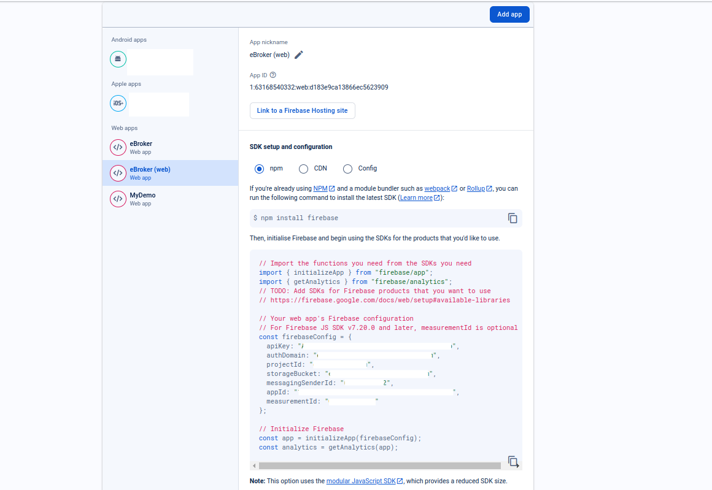
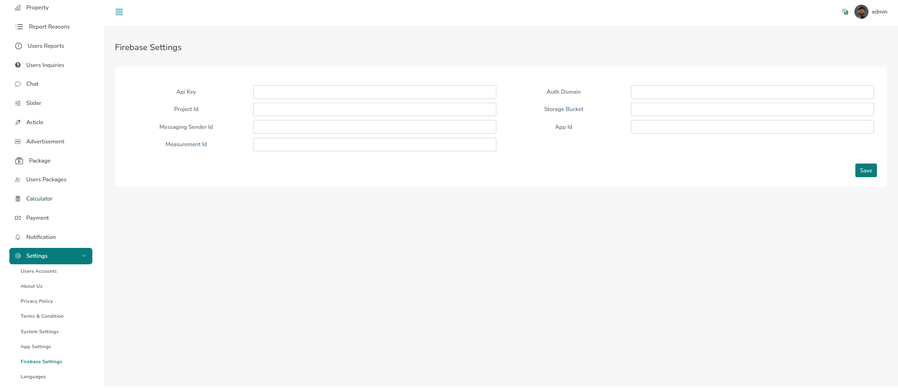

# Firebase Settings

Go to your web firebase project->settings->General

Copy One by one Configuration values From this Section and add in Admin Panel -> Settings -> Firebase Settings

:::warning
Use the same Firebase project here and in [Notification Settings](./notification-settings.md). From v1.9.2, sign-ins from any other project are refused.
:::
