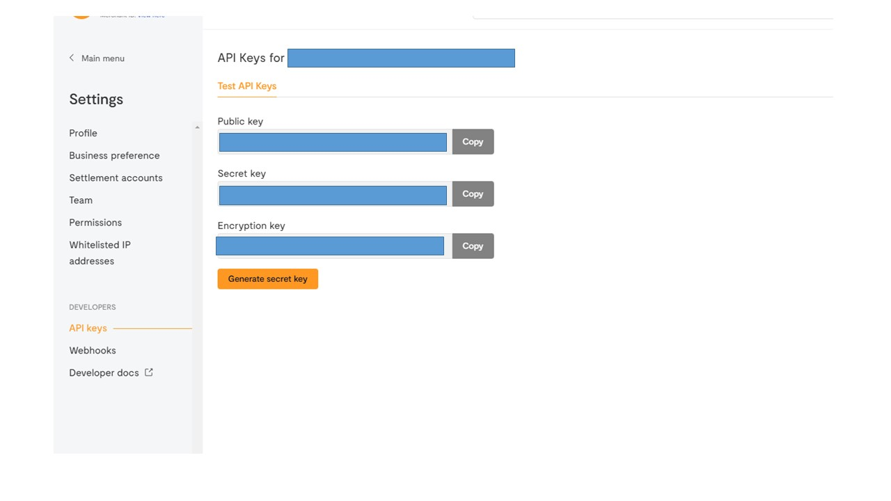
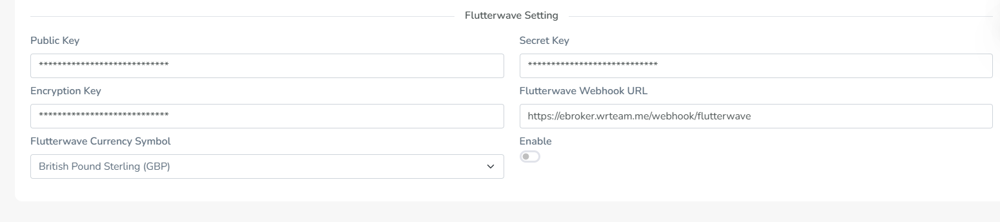
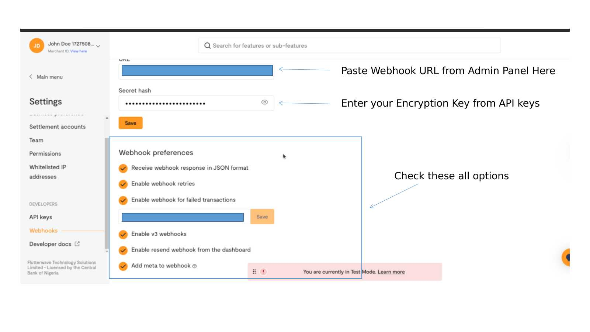

# Flutterwave Setup

## Api Keys Settings

Step 1: Login to Flutterwave Dashboard  
Step 2: Settings -> Developers -> API keys

Step 3: Copy All Public Key, Secret Key and Encryption Key, and paste it in admin panel system settings under Flutterwave Setting

Step 4: Save Settings in admin panel

## Setup Webhook

Step 1: In Admin panel System Setting copy the under flutterwave settings, copy flutterwave webhook url

Step 2: In Flutterwave Dashboard, Head to Settings -> Developers -> Webhook

Step 3: Set the webhook **Secret hash** in Flutterwave to the same value as the **Encryption Key** saved in the Admin Panel. eBroker compares the two and rejects webhooks that do not match.

## Store currency

Set the Flutterwave currency in `Settings` → `Payment Settings`. Payments are refused if it differs from the store currency in [System Settings](./system-configurations.md#more-settings) (v1.9.2+).
