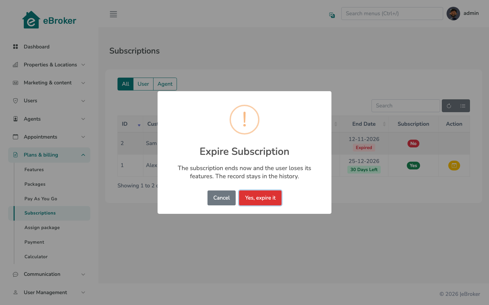

# Expire a Subscription

From v1.9.2, an admin can end a running subscription early.

1. Open `Plans & billing` → `Subscriptions`.
2. Click the **Expire Subscription** button in the **Action** column. It appears only on running subscriptions.
3. Confirm with **Yes, expire it**.

:::caution
The subscription ends immediately and the user loses its features. The record stays in the history. No refund is issued; handle that with the payment gateway.
:::

Staff need the **update** permission on User Package.
