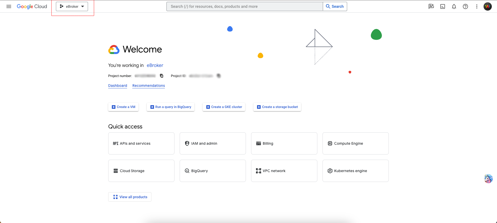
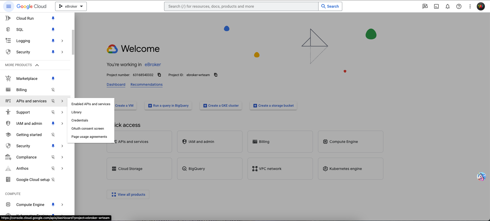
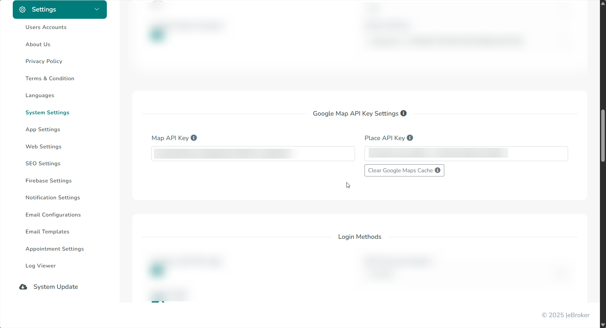

# Map API Key and Place API

Maps, location search and address suggestions in your app, admin panel and website all run on Google services. To turn them on, you need to do three things in Google Cloud Console:

1. Turn on the Google services (APIs) the product uses.
2. Create **two API keys**, one for your server and one for your websites.
3. Paste both keys into the admin panel.

This takes about 15 minutes. You need a Google account and a credit or debit card for billing (see Step 1).

> **Since version 1.7.0:** the app, admin panel and website use **Places API (New)** instead of the older **Places API**. If you are setting this up for the first time, follow the steps below as written. If you are upgrading from an older version, see [Upgrading from the legacy Places API](#upgrading-from-the-legacy-places-api) at the end of this page.

## What you will create

| Key | What it is used for | How to restrict it |
| --- | --- | --- |
| **Server key** | Address search, converting addresses to locations | By your server's IP address |
| **Web key** | Showing maps in the admin panel and on your website | By your website addresses (HTTP referrer) |

Restricting a key means Google only accepts it from your own server or websites. If someone copies the key, it will not work anywhere else, so nobody can run up charges on your account.

## Step 1: Set up your Google Cloud project

1. Open [Google Cloud Console](https://console.cloud.google.com) and sign in.
2. Select your project at the top of the page. If you do not have one, create a new project.



3. **Turn on billing** for the project. Open the menu, go to **Billing**, and link a billing account.

   > **Important:** Billing is required. Without it, location search will not work in the app, admin panel or website. Google gives a free monthly credit, so small usage is usually free.

## Step 2: Turn on the 6 APIs

1. In Google Cloud Console, open **APIs & Services** and then **Library**.
2. Search for each API below by its exact name, open it, and click **Enable**:

   - Geocoding API
   - **Places API (New)**
   - Geolocation API
   - Maps JavaScript API
   - Maps SDK for Android
   - Maps SDK for iOS

   > **Note:** **Places API (New)** is a different entry from the older **Places API**. Make sure you enable the one that says "(New)".



## Step 3: Create the server key

This key is used by your server for address search.

1. Go to **APIs & Services** and then **Credentials**.
2. Click **Create credentials** and then **API key**. Click **Close** on the popup.
3. Click the new key to open it. Rename it to **Server key**.
4. Under **Application restrictions**, choose **IP addresses**.
5. Click **Add an IP address** and enter your server's IP address. If your server has both an IPv4 and an IPv6 address, add both. If you do not know your server IP, ask your hosting provider.
6. Under **API restrictions**, choose **Restrict key** and select only these three APIs:
   - Places API (New)
   - Geocoding API
   - Geolocation API
7. Click **Save**.

## Step 4: Create the web key

This key shows maps in the admin panel and on your website. **You only need one web key for both.** You list both addresses on the same key.

1. On the **Credentials** page, click **Create credentials** and then **API key**. Click **Close** on the popup.
2. Click the new key to open it. Rename it to **Web key**.
3. Under **Application restrictions**, choose **Websites** (this is the HTTP referrer option).
4. Click **Add** and enter the first address below, then click **Add** again for each of the others. Put `/*` at the end of each one:

   ```
   https://admin.yourdomain.com/*
   https://yourdomain.com/*
   https://www.yourdomain.com/*
   ```

   What each line is:
   - **Line 1:** the address where your **admin panel** is hosted. Replace `admin.yourdomain.com` with your real admin panel address. It can be a subdomain (like `admin.yourdomain.com`) or a path on your main domain.
   - **Line 2:** your **website** address without `www`.
   - **Line 3:** your **website** address with `www`.

   Tips:
   - Use your real domains and keep `https://` at the start.
   - Use the exact subdomain your admin panel opens on. `admin.yourdomain.com` and `panel.yourdomain.com` are different addresses.
   - If your website only opens with `www` or only without it, add just that one.
   - If you test on your own computer, you can also add `http://localhost/*`.

5. Under **API restrictions**, choose **Restrict key** and select only **Maps JavaScript API**.
6. Click **Save**.

> Changes to a key can take a few minutes to start working.

## Step 5: Add the keys to the admin panel

1. Copy the **Server key** from the Credentials page (click **Show key**).
2. Log in to your admin panel and go to **System Settings**.
3. Paste the Server key into the **Places API** field.
4. Go back to Google Cloud Console, copy the **Web key**, and paste it into the **Map API Key** field.
5. Click **Save**.



> **Note:** The field is called "Places API" in the admin panel. The server key you paste there is checked against Places API (New).

## If something does not work

- **Location search shows no results:** check that billing is turned on and that **Places API (New)** is enabled.
- **The map shows "This page can't load Google Maps correctly":** the web key does not include the address you are on. Add the exact address, ending in `/*`, to the web key and wait a few minutes.
- **Address search fails on the server:** check that the server IP in the Server key matches your hosting provider's current IP.
- **A key was just changed:** Google can take up to 5 minutes to apply changes. Wait, then try again.

## Using a single key instead (not recommended)

If you want a simpler setup, you can use one key for everything. Enable all four APIs on it (Places API (New), Geocoding API, Geolocation API, Maps JavaScript API), leave it unrestricted, and paste the same key into both the **Map API Key** and **Places API** fields.

We do not recommend this for a live site. An unrestricted key can be copied and used by anyone, and you pay for their usage.

## Upgrading from the legacy Places API

If your project was set up before version 1.7.0 and already has the older **Places API** enabled with a working key, switch it over like this:

1. In [Google Cloud Console](https://console.cloud.google.com), open **APIs & Services** and then **Library**, and enable **Places API (New)** on the same project.
2. You do not need new keys. The same key works once Places API (New) is enabled. If your key is restricted to a list of APIs, add **Places API (New)** to that list.
3. You do not need to change anything in the admin panel. The **Places API** field keeps the key you already saved.
4. After you confirm location search still works, you can disable the older **Places API** in Google Cloud Console. This step is optional.

See the [changelog](../changelog/index.md) for the full 1.7.0 release notes.
