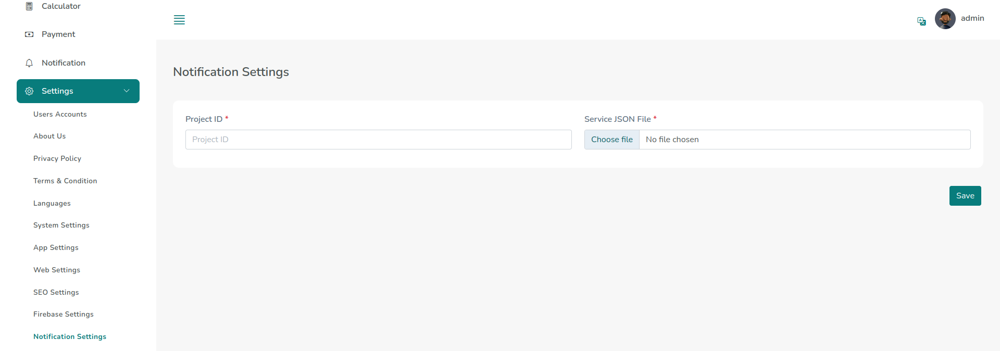
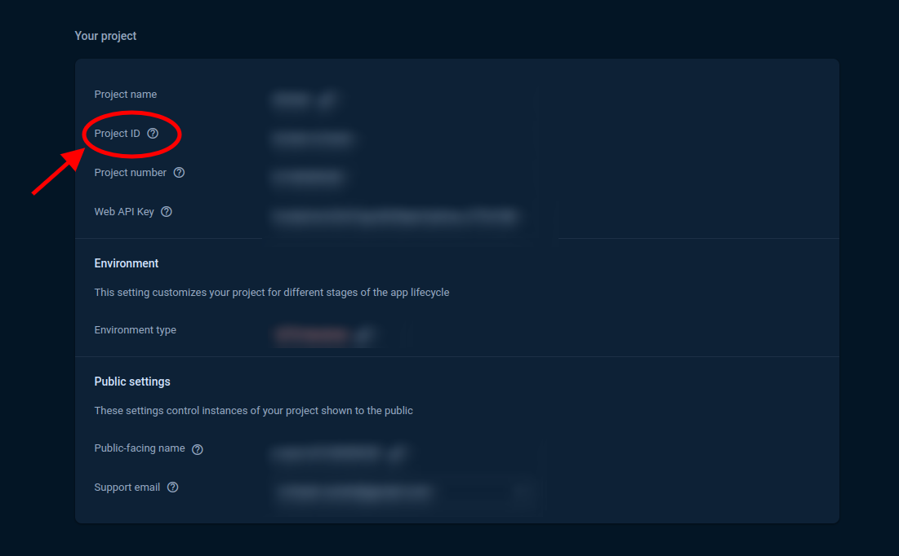
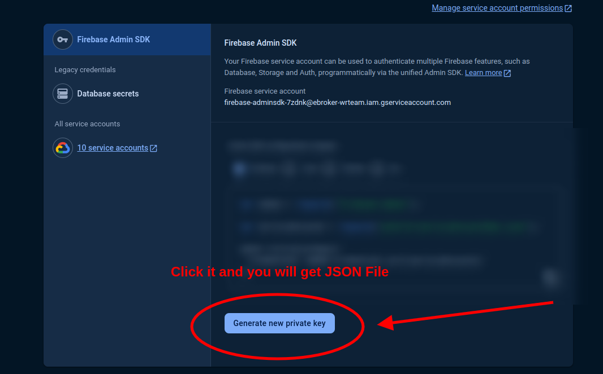

# Notification Settings

Update Project Id and Service JSON File

:::warning
From v1.9.2, the **Project ID** is also used to verify Firebase sign-ins. While it is empty or belongs to another Firebase project, Google and Apple login fail, and so do phone registration and password reset through Firebase.
:::

## Get Project ID

Go to Firebase -> Project -> Project Settings -> General

## Get Service JSON File

Go to Firebase -> Project -> Project Settings -> Service Accounts

