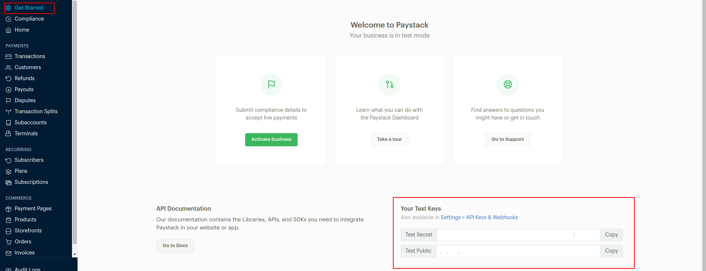
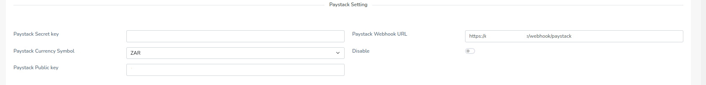

# Paystack Setup

## Set API Keys

Step 1: Login to Paystack Dashboard  
Step 2: Go to get Started section you can find Your Test Keys Section

Step 3: Copy Test secret key and Test Public Key and paste it in admin panel system settings

## Setup Webhook

Step 1: Login to Paystack Dashboard  
Step 2: Click Settings  
Step 3: Click API keys and webhooks

Step 4: Copy Paystack Webhook from Admin panel  
Settings -> System Settings and paste here

.png>)

## Webhook secret

Paystack signs webhooks with your **Secret Key**. If that key is empty or wrong, webhooks are rejected and packages are not activated.

## Store currency

Set the Paystack currency in `Settings` → `Payment Settings`. Payments are refused if it differs from the store currency in [System Settings](./system-configurations.md#more-settings) (v1.9.2+).
