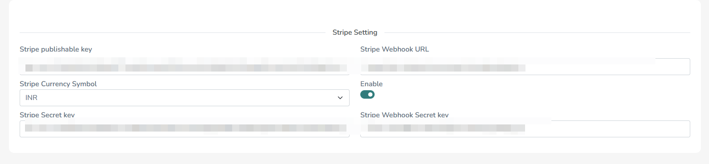

# Stripe Setup

## Set API Keys

Step 1: Login to Stripe Dashboard
Step 2: Click API keys

<!-- .png>) -->

Step 3: Copy publishable key and secret keys and paste it in admin panel system settings

## Setup Webhook

Step 1: Login to Stripe Dashboard  

Step 2: Developers -> Webhooks

Step 3: Click Add endpoint

Step 4: Select Required Events

Step 5: Continue -> Select Webhook Event -> Continue

Step 6: Add Webhook URL from admin and required fields -> Create 

Step 7: Copy the webhook **Signing secret** (`whsec_...`) and add it in admin panel -> Settings -> Payment Settings -> **Stripe Webhook Secret key**

:::warning
From v1.9.2, Stripe webhooks are rejected while this key is empty or wrong.
:::

## Store currency

Set the Stripe currency in `Settings` → `Payment Settings`. Payments are refused if it differs from the store currency in [System Settings](./system-configurations.md#more-settings) (v1.9.2+).
