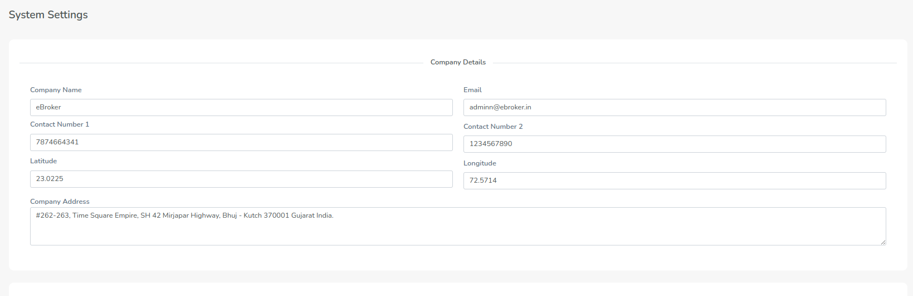
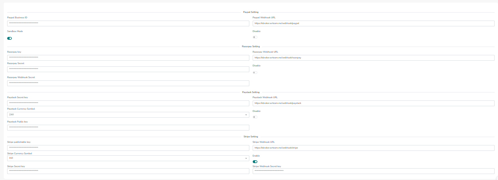
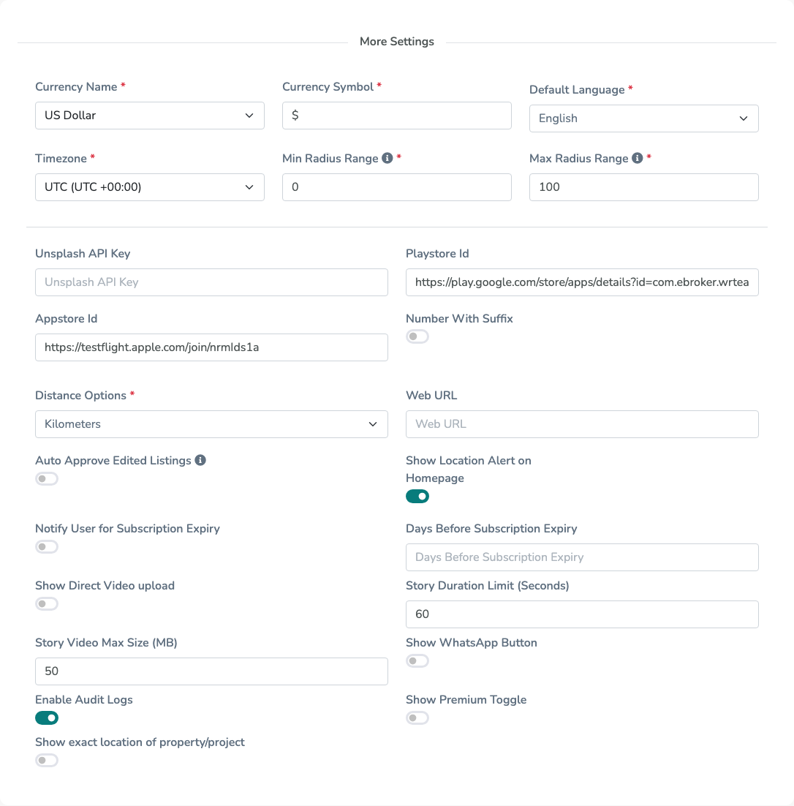
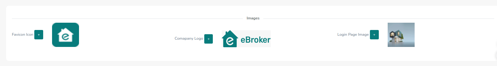
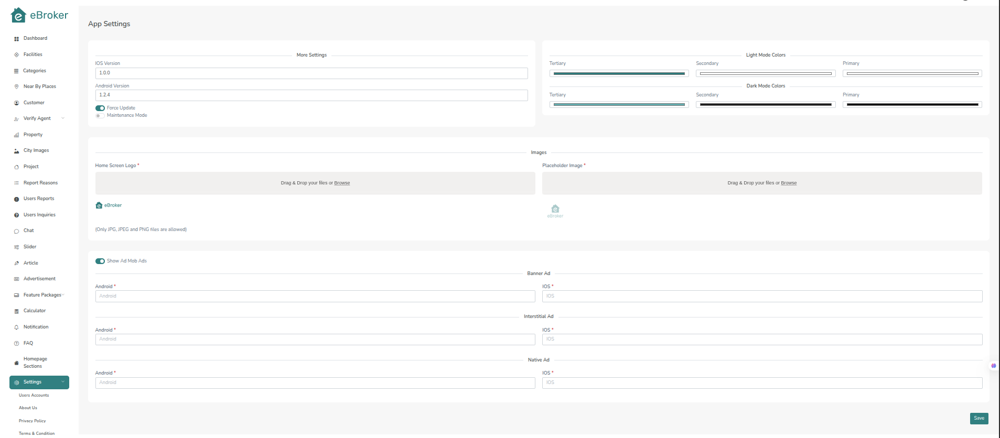
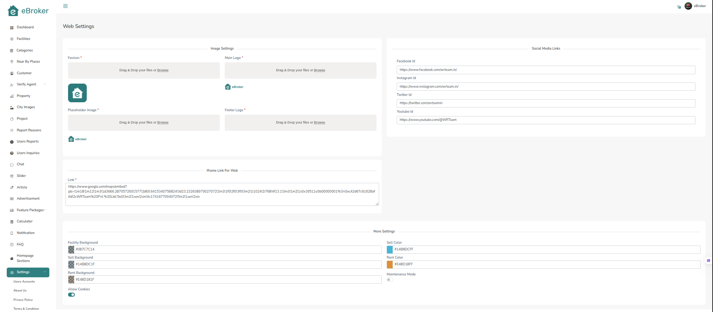

# Set System Configurations

## Company Details

## Payment Details

## More Settings

:::warning Store currency (v1.9.2)
**Currency Name** must match the currency your payment gateway charges, otherwise the payment is refused with "This payment method cannot be used with the store currency." Set it before taking online payments.

| Gateway | Charges in |
| --- | --- |
| Razorpay | The store currency |
| Stripe, PayPal, Paystack, Flutterwave, Cashfree, PayU | The currency set on the gateway |
| PhonePe | `INR` |
| Midtrans | `IDR` |
:::

Colors moved to [Theme Settings](./theme-settings.md).

## Image Settings

## App Settings

## Web Settings

