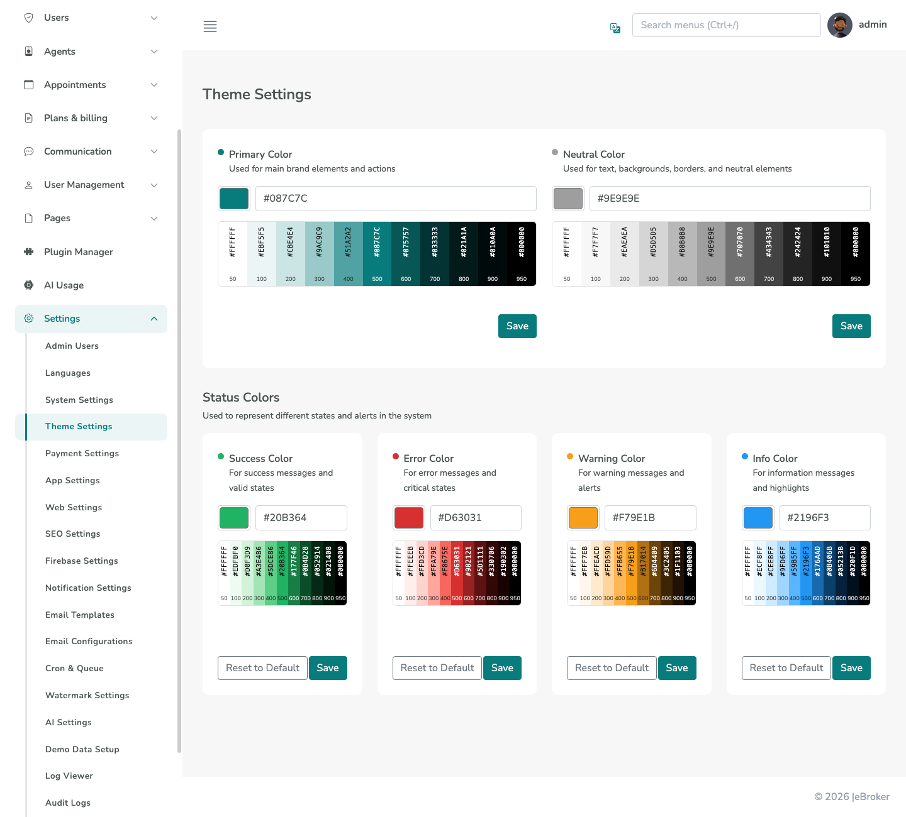

# Theme Settings

From v1.9.2, colors are managed in `Settings` → `Theme Settings`. The **System Color** field in System Settings was removed; your saved color is kept as the **Primary Color**.

| Color | Used for | Default |
| --- | --- | --- |
| Primary | Main brand elements and actions | `#087C7C` |
| Neutral | Text, backgrounds, borders | `#9E9E9E` |
| Success | Success messages, valid states | `#20B364` |
| Error | Error messages, critical states | `#D63031` |
| Warning | Warning messages, alerts | `#F79E1B` |
| Info | Information messages, highlights | `#2196F3` |

## Change a color

1. Pick a color or type its HEX value. The 50 to 950 shades are generated and previewed for you; nothing is saved yet.
2. Click **Save** on that color. Each color is saved separately.

**Reset to Default** is available for the four status colors.

:::info
Messages under the shades are advice, not errors, for example when a color is close to white or black, or when text on it cannot reach 4.5:1 contrast. You can still save.
:::

Viewing this page needs the `System Settings` read permission; saving needs update.
