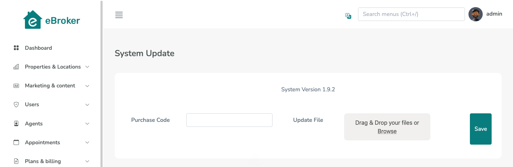
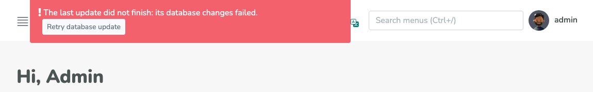

# Update System Version

1. Take backup of your current version code (including `storage/app`) and database
2. Download latest code from codecanyon
3. Check update Instruction before update the system
4. Extract code, extract admin code and head to update folder in admin code
5. Then in your admin panel -> system update
    - Add Purchase code
    - Upload the update zip file for the version you want to update to. For example, if your current version is 1.3.0, then upload 1.3.0-to-1.3.1.zip file
    - Click on save and wait to update

:::warning
You have to update your admin system version by version, like if currently it's 1.2.9 then update to 1.3.0 and then 1.3.1.
If possible, check after every version update that the system is working properly, then take backup of the current version and proceed for the next version update.
:::

## Updating to v1.9.2

**Before**

- PHP 8.2 or newer with the **zip** extension, and about **250 MB** of free disk space.
- Log in as the **super admin**. From v1.9.2 other admins cannot run updates.

**After**

1. Set the **store currency** in [System Settings](./system-configurations.md#more-settings). It is filled with USD only if it was empty and your symbol is `$`, `US$` or blank.
2. Set the **iOS Bundle ID** if you sell packages in the iOS app ([Apple In-App Purchase](./apple-iap-setup.md)).
3. Check that every payment gateway has its **webhook secret** saved. Unsigned webhooks are now rejected.
4. Check the Firebase **Project ID** in [Notification Settings](./notification-settings.md).
5. Review [staff permissions](./staff-permissions.md).
6. If the admin password is still `admin123`, you will be asked to change it.

**Good to know**

- Your `public/.htaccess` is not overwritten.
- Bank receipts and verification documents move from the public folder to `storage/app/private`. Include that folder in backups.
- Scripts and unsafe HTML are removed from Privacy Policy, Terms, About Us and Custom Pages.

## If the database update fails

A notice appears at the top of the panel. Click **Retry database update**. If it fails again, contact [support](./support.md) with the latest file from `storage/logs`.

