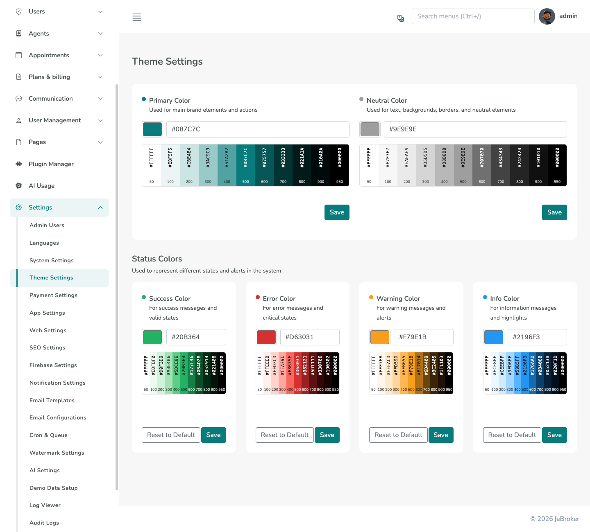
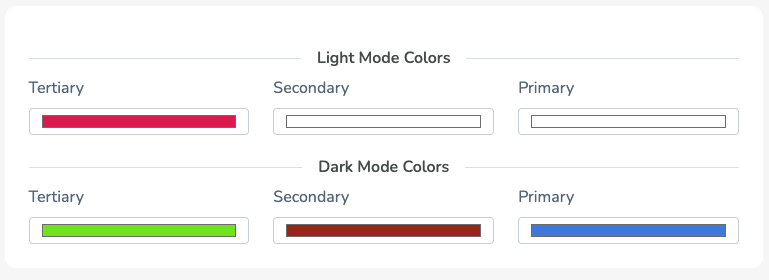
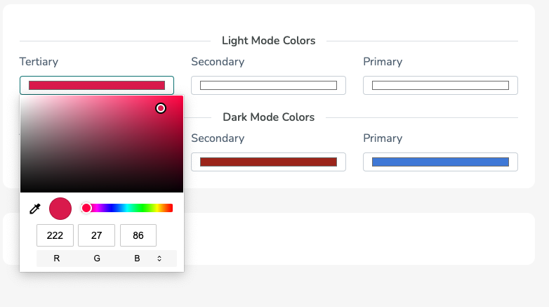
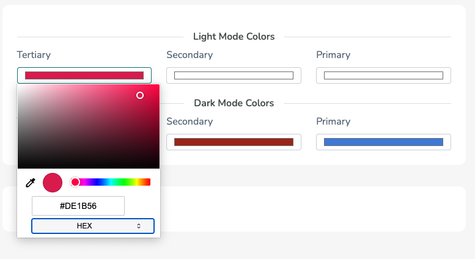
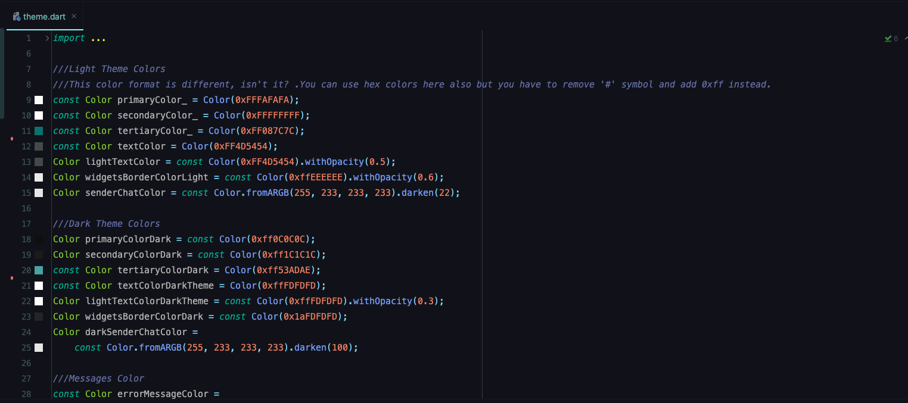

# Theme Colors

Customizing your app's theme colors helps align it with your brand identity. Here's how to do it:

## Using Theme Settings (v1.9.2+)

From v1.9.2, app colors come from **Theme Settings** in the Admin Panel. The same colors are used by the website.

1. Go to Admin Panel → Settings → Theme Settings
2. Pick a color or type its HEX value. The shades are generated automatically
3. Click **Save** on that color
4. Restart the app to load the new colors. No new build is needed

See [Theme Settings](../admin/theme-settings.md) for what each color controls.

### Fallback colors

On first launch, before the app has reached your server, it uses the bundled file `assets/theme/color_tokens_fallback.json`. To make it match your brand:

1. Save your colors in Theme Settings
2. Open `https://your-admin-domain.com/api/color-tokens`
3. Replace the contents of `assets/theme/color_tokens_fallback.json` with the **`data` object** of that response (not the whole response) and rebuild the app

## Using App Settings (v1.1.0 to v1.9.1)

For these versions, you can change theme colors directly from the admin panel:

1. Go to Admin Panel → Settings → App Settings
2. Locate the theme color change section
3. Pick a color by tapping on any of the color options

4. You'll see a popup like this:

5. Tap on R, G, B text to switch to hex mode:

6. Enter your desired hex color code and save
7. Restart your app to see the updated colors

## Setting Fallback Colors (up to v1.9.1)

In case the colors fail to load from the server, you can set fallback colors in the app code:

1. Navigate to the theme.dart file in your project
2. Set fallback theme colors as shown below:

This ensures your app always has consistent styling, even if there are connection issues with the server.
