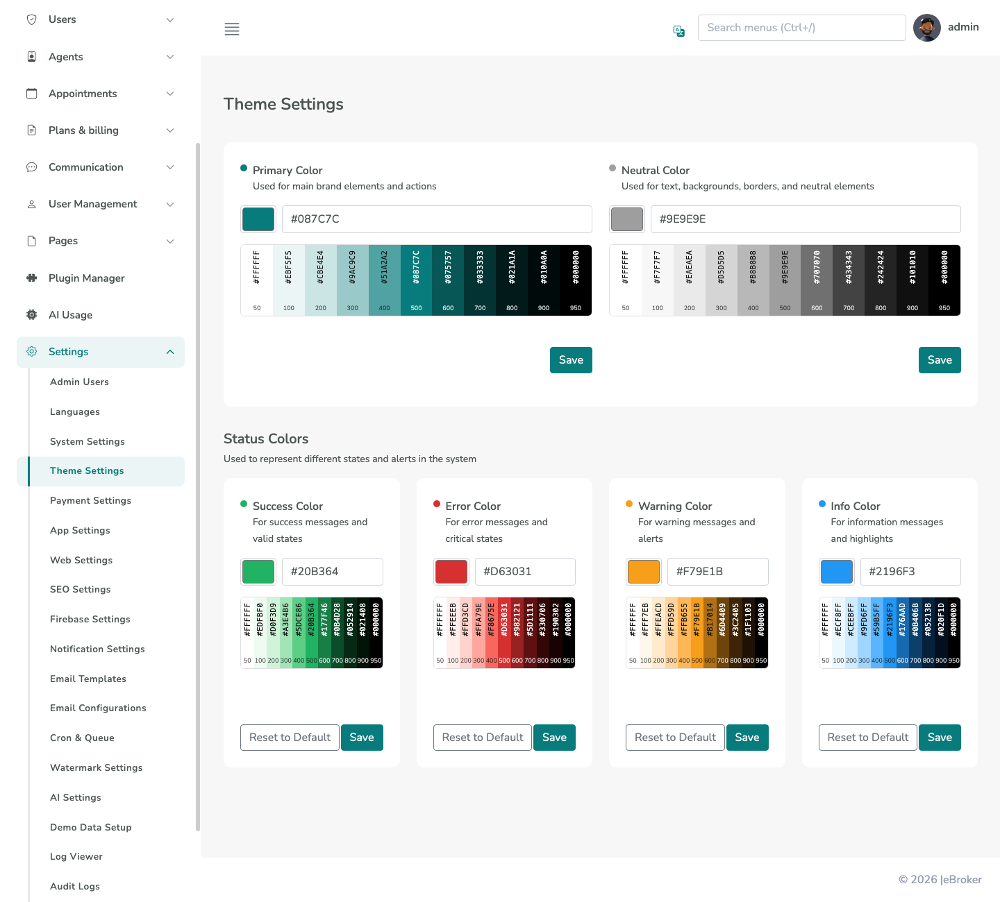
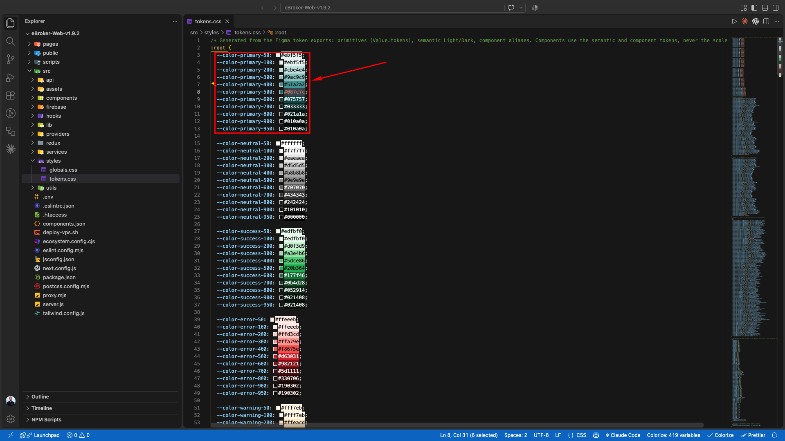

# Color Customization

Customizing the color scheme of your eBroker web application helps align it with your brand identity and creates a consistent user experience.

## Setting System Colors via Admin Panel

The quickest way to change colors is through the admin panel — no code changes required.

1. Log in to your admin panel
2. Navigate to **Settings → Theme Settings** (v1.9.2+)
3. Pick a color or type its HEX value. The shades are generated automatically
4. Click **Save** on each color you changed



See [Theme Settings](../admin/theme-settings.md) for what each color controls.

:::info Up to v1.9.1
Use **Settings → System Settings → More Settings → System Color** instead. This field was removed in v1.9.2, and its saved value became the **Primary Color**.
:::

## Best Practice: Hardcoding Colors in Source Code

For a more reliable and permanent color setup, especially in production deployments, it is recommended to **set your brand colors directly in the source code** inside `src/styles/tokens.css`. This ensures that your colors are always applied consistently, regardless of admin panel settings or caching issues.

:::note Recommended, not required
This step is recommended, not required. The `FullScreenSpinner` shows its ring in the primary color from `tokens.css` while the web app loads, before the admin panel color is applied. If your brand color differs from the default, visitors may see a brief flash of the default color. Setting your primary color in `tokens.css` avoids this flash.
:::

### Where to Edit

Open the file `src/styles/tokens.css` in your project. The `:root` block at the top of the file defines the color tokens. The brand color is the **primary scale**, `--color-primary-50` to `--color-primary-950`.



As shown in the screenshot above, replace the hex values of the `--color-primary-*` tokens (highlighted in red) with the shades of your brand color.

:::note
Components use the semantic and component tokens, which are built from this scale. Edit the `--color-primary-*` values only and do not rename the tokens.
:::

### Step-by-Step Instructions

1. Open `src/styles/tokens.css` in your code editor.
2. Locate the `:root { ... }` block and the `--color-primary-50` to `--color-primary-950` lines at the top (lines 3–13, as shown in the screenshot).
3. Replace each value with the matching shade of your brand color. `--color-primary-500` is the main brand shade:
   ```css
   --color-primary-500: #YOUR_HEX_CODE;
   ```
   Use a shade generator (for example, from your brand hex) to get the lighter (50–400) and darker (600–950) shades.
4. Update the neutral, success, error and warning scales in the same file if your brand palette needs them.
5. Save the file.
6. Restart the development server (`npm run dev`) or rebuild the production bundle (`npm run build`) to see the changes take effect.

## Key Color Elements

The eBroker web application allows you to customize several color elements:

- **Primary Color**: Main brand elements and actions
- **Neutral Color**: Text, backgrounds, borders, and neutral elements
- **Status Colors**: Success, error, warning, and info messages

## Color Selection Tips

When selecting colors for your web application:

- Use colors that match your brand identity
- Limit your color palette to 2–3 main colors for a clean look
- Consider color psychology (e.g., blue for trust, green for growth)
- Test your color choices on different devices and screen sizes

## Applying Color Changes

After setting your custom colors:

1. **Via Admin Panel**: Save your changes — the web application will update automatically. You may need to clear your browser cache to see the updated colors.
2. **Via Source Code (`tokens.css`)**: Save the file and restart or rebuild the application. Changes are applied globally and take effect immediately on the next page load.
